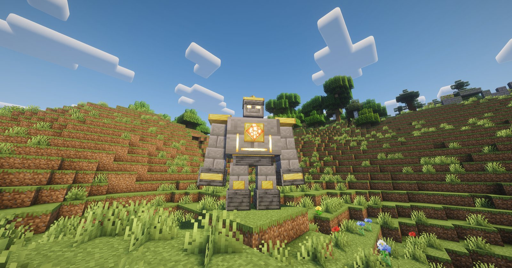
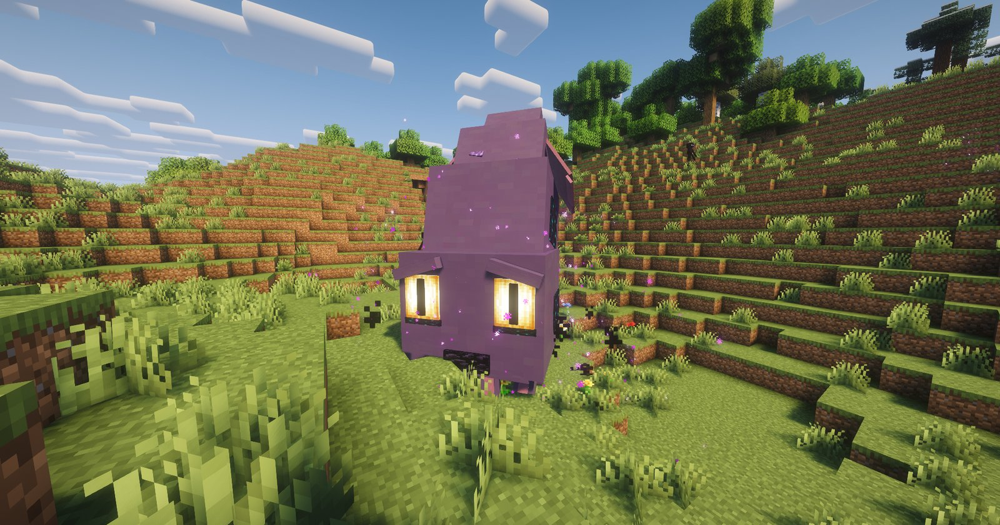

# SunBossy

**English** · [Polski](README.pl.md)

Seven multi-phase bosses for Paper 26.2. Every boss model is made of block displays and animated server-side, so players don't need a resource pack or client mods.

<p align="center">
  
  
</p>

## Bosses

| Boss | ID | What makes the fight |
|---|---|---|
| Strażnik Słońca (Sun Guardian) | `straznik` | Ground slams you jump over, thrown boulders, a sun core you must break before it explodes. In phase 2 he drops his golden armor and fires fireballs. |
| Smok Burzy (Storm Dragon) | `smok` | Flies around the arena, dives and calls down lightning. Break the storm crystals to knock him out of the sky. |
| Kraken Pustki (Void Kraken) | `kraken` | Rises from the void next to an island edge. Tentacles slam and grab players, and the head blinds with ink. |
| Organista Pustki (Void Organist) | `organista` | Dungeon boss with no automatic event. Summon it by command. |
| Kowal Burzowej Kuźni (Stormforge Smith) | `kowal` | Forged swords, burning arena sectors. At 50% he splits into three golems that must all be broken in time. |
| Lodowy Wilk Alfa (Frost Alpha) | `wilk` | Marks a target, leaps around the arena, howls up a wolf pack and turns into a blizzard in phase 2. |
| Królowa Roju (Hive Queen) | `krolowa` | Bee swarm, eggs to smash before they hatch, honey puddles. At 40% the hive collapses and she takes to the air. |

## Features

- Boss bar, damage numbers and phases with telegraphed attacks
- Rewards split by damage dealt: everyone above 3%, an extra for the top 3 and for the top 1
- Altars: right-click one while holding the summoning item, or wait for the automatic event every few hours (announced 5 and 1 minute before)
- Knockback never throws players into the void, and bosses won't jump where there is no ground
- Bosses leave after 45 seconds with no players around
- Rewards are plain console commands, so they work with any plugin

## Requirements

- Paper **26.2**
- Java **25**
- [SunCore](https://github.com/oonnyyx/SunCore)

## Installation

1. Download `SunBossy.jar` and `SunCore.jar` from [Releases](../../releases/latest).
2. Drop both into `plugins/` and restart the server.
3. Look at the altar block, stand where the arena should be, and run `/bossy oltarz <id>`.

## Commands

All commands require `bossy.admin` (op by default). Alias: `/boss`.

| Command | Description |
|---|---|
| `/bossy przywolaj <id> [world x y z]` | Summon a boss 8 blocks in front of you, or at the given coordinates |
| `/bossy oltarz <id>` | Turn the block you're looking at into an altar; the arena is where you stand |
| `/bossy usun-oltarz` | Remove the altar you're looking at |
| `/bossy przedmiot <id> [player] [amount]` | Give the summoning item |
| `/bossy event <id> [teraz]` | Start the altar event with a 5-minute countdown, or in 10 seconds with `teraz` |
| `/bossy zabij` | Remove active bosses |
| `/bossy lista` | Show active bosses and altars |
| `/bossy reload` | Reload `config.yml` |

## Configuration

`config.yml` controls each boss's base HP and HP per player, rewards, event interval, minimum players online and altar cooldown. Default rewards use [SunSkrzynki](https://github.com/oonnyyx/SunSkrzynki) keys and [SunPrzedmioty](https://github.com/oonnyyx/SunPrzedmioty) items, so swap them out if you don't run those plugins.

In-game messages are in Polish.

## Building

```bash
git clone https://github.com/oonnyyx/SunCore && cd SunCore && mvn install && cd ..
git clone https://github.com/oonnyyx/SunBossy && cd SunBossy && mvn package
```

The jar ends up in `target/SunBossy.jar`.

## License

[MIT](LICENSE)
