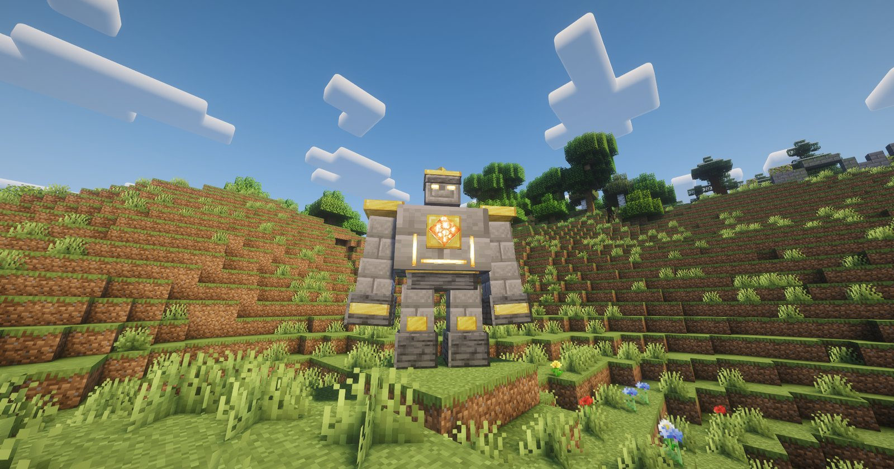
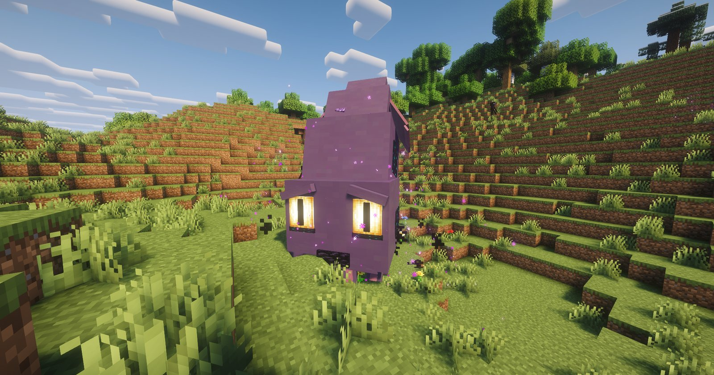

# SunBossy

[English](README.md) · **Polski**

Siedmiu wielofazowych bossów na Paper 26.2. Każdy model bossa jest zbudowany z block displayów i animowany po stronie serwera, więc gracze nie potrzebują paczki zasobów ani modów.

<p align="center">
  
  
</p>

## Bossowie

| Boss | ID | Na czym polega walka |
|---|---|---|
| Strażnik Słońca | `straznik` | Uderzenia w ziemię do przeskoczenia, rzuty głazem i rdzeń słońca, który trzeba rozbić, zanim wybuchnie. W 2. fazie zrzuca złotą zbroję i strzela kulami ognia. |
| Smok Burzy | `smok` | Krąży nad areną, nurkuje i ściąga pioruny. Rozbite kryształy burzy strącają go na ziemię. |
| Kraken Pustki | `kraken` | Wynurza się z pustki przy krawędzi wyspy. Macki biją i chwytają graczy, a głowa oślepia atramentem. |
| Organista Pustki | `organista` | Boss lochu bez automatycznego eventu. Przywołuje się go komendą. |
| Kowal Burzowej Kuźni | `kowal` | Wykute miecze i płonące wycinki areny. Przy 50% rozpada się na trzy golemy, które trzeba rozbić na czas. |
| Lodowy Wilk Alfa | `wilk` | Oznacza cel, skacze po arenie, przywołuje watahę wyciem, a w 2. fazie zamienia się w zamieć. |
| Królowa Roju | `krolowa` | Rój pszczół, jaja do rozbicia, zanim się wyklują, i kałuże miodu. Przy 40% ul się wali i królowa przechodzi do walki w powietrzu. |

## Co potrafi

- Pasek bossa, liczby obrażeń i fazy z sygnalizowanymi atakami
- Nagrody dzielone według zadanych obrażeń: dla każdego powyżej 3%, dodatkowe dla top 3 i dla top 1
- Ołtarze: boss przychodzi po kliknięciu ołtarza PPM z przedmiotem przywołania w ręce albo sam co kilka godzin (ogłoszenie 5 i 1 minutę wcześniej)
- Odrzut nigdy nie wyrzuca gracza w pustkę, a boss nie skoczy tam, gdzie nie ma gruntu
- Boss znika po 45 sekundach bez graczy w pobliżu
- Nagrody to zwykłe komendy z konsoli, więc działają z każdym pluginem

## Wymagania

- Paper **26.2**
- Java **25**
- [SunCore](https://github.com/oonnyyx/SunCore)

## Instalacja

1. Pobierz `SunBossy.jar` i `SunCore.jar` z zakładki [Releases](../../releases/latest).
2. Wrzuć oba pliki do `plugins/` i zrestartuj serwer.
3. Spójrz na blok ołtarza, stań tam, gdzie ma być arena, i wpisz `/bossy oltarz <id>`.

## Komendy

Wszystkie wymagają `bossy.admin` (domyślnie op). Alias: `/boss`.

| Komenda | Opis |
|---|---|
| `/bossy przywolaj <id> [świat x y z]` | Przywołuje bossa 8 kratek przed tobą albo we wskazanym miejscu |
| `/bossy oltarz <id>` | Robi ołtarz z bloku, na który patrzysz; arena jest tam, gdzie stoisz |
| `/bossy usun-oltarz` | Usuwa ołtarz, na który patrzysz |
| `/bossy przedmiot <id> [gracz] [ilość]` | Daje przedmiot przywołania |
| `/bossy event <id> [teraz]` | Odpala event przy ołtarzu z 5-minutowym odliczaniem albo po 10 sekundach z `teraz` |
| `/bossy zabij` | Usuwa aktywnych bossów |
| `/bossy lista` | Pokazuje aktywnych bossów i ołtarze |
| `/bossy reload` | Przeładowuje `config.yml` |

## Konfiguracja

W `config.yml` ustawisz dla każdego bossa życie bazowe i życie na gracza, nagrody, częstotliwość eventów, minimalną liczbę graczy online i cooldown ołtarza. Domyślne nagrody korzystają z kluczy [SunSkrzynki](https://github.com/oonnyyx/SunSkrzynki) i przedmiotów [SunPrzedmioty](https://github.com/oonnyyx/SunPrzedmioty). Jeśli nie masz tych pluginów, podmień je na własne komendy.

## Budowanie

```bash
git clone https://github.com/oonnyyx/SunCore && cd SunCore && mvn install && cd ..
git clone https://github.com/oonnyyx/SunBossy && cd SunBossy && mvn package
```

Gotowy plik: `target/SunBossy.jar`.

## Licencja

[MIT](LICENSE)
